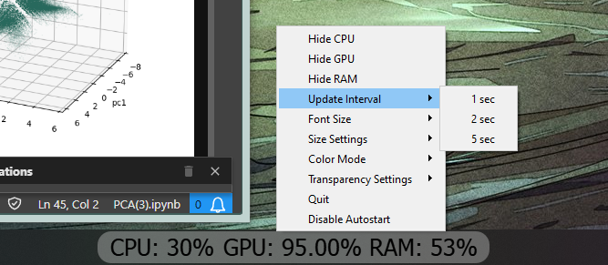

# Resource Monitor Widget

A lightweight and customizable always-on-top resource monitor for Windows
10/11 that displays current CPU, GPU, and RAM usage.

The widget can be resized and moved freely on the screen and supports
customizable font size, transparency, color modes, update intervals, and
optional Windows autostart.


## Features

- Monitors CPU, GPU, and RAM usage.
- Uses native Windows API calls for CPU and RAM monitoring.
- Supports NVIDIA GPU monitoring through GPUtil.
- Resizable and movable always-on-top widget.
- Optional autostart with Windows 10/11.
- Independent background and text transparency settings.
- Adjustable font size and update interval.
- System and dynamic usage-based color modes.
- Saves the widget position between launches.

## Quick Start

The precompiled executable is published through GitHub Releases.

Alternatively, ResourceMonitor can be run directly from Python source as
described below.

## Running from Source

1. Clone the repository:

   ```powershell
   git clone https://github.com/AlexKlos/ResourceMonitor.git
   cd ResourceMonitor
   ```

2. Create and activate a virtual environment:

   ```powershell
   python -m venv venv_resource_monitor
   .\venv_resource_monitor\Scripts\Activate.ps1
   ```

3. Install the required dependencies:

   ```powershell
   python -m pip install -r requirements.txt
   ```

4. Run the application:

   ```powershell
   python resource_monitor.py
   ```

## Autostart

Autostart can be enabled or disabled from the ResourceMonitor context menu.

When enabled, ResourceMonitor creates `ResourceMonitor.bat` in the current
user's Windows Startup folder. The startup script launches the executable
from its current location.

ResourceMonitor does not require administrator privileges for autostart.

When autostart is disabled, the Startup script is removed. The application
also removes the legacy registry autostart entry used by earlier versions,
if such an entry exists.

## Customization Options

- **Metrics Selection**: Choose which metrics to display: CPU, GPU, and RAM.
- **Font Size**: Set a custom font size from the context menu.
- **Widget Size**: Configure the width and height of the widget.
- **Transparency**: Control background and text transparency independently.
- **Color Modes**:
  - **System**: Uses the default system text color.
  - **Colored**: Changes the text color dynamically according to resource
    usage, from green through yellow to red.
- **Update Interval**: Choose a refresh interval of 1, 2, or 5 seconds.
- **Startup Position**: The widget position is saved and restored on the
  next launch.
- **Autostart**: Enable or disable automatic startup with Windows.



## Requirements

For the precompiled executable:

- Windows 10 or Windows 11.
- NVIDIA drivers are required only for GPU utilization monitoring.

For running from source:

- Windows 10 or Windows 11.
- Python 3.12 is tested.
- PyQt5.
- GPUtil.

CPU and RAM utilization are queried directly through the Windows API and
do not require `psutil`.

## Building the Executable

ResourceMonitor can be compiled into a standalone one-file executable using
Nuitka.

Install Nuitka in the active virtual environment:

```powershell
python -m pip install nuitka
```

Build the executable:

```powershell
python -m nuitka --standalone --onefile `
  --enable-plugin=pyqt5 `
  --windows-console-mode=disable `
  --windows-icon-from-ico=icon.ico `
  --windows-company-name="AlexKlos" `
  --windows-product-name="ResourceMonitor" `
  --windows-file-description="Floating CPU/GPU/RAM resource monitor" `
  --windows-file-version=1.2.0.0 `
  --windows-product-version=1.2.0.0 `
  --lto=yes `
  --nofollow-import-to=tkinter `
  resource_monitor.py
```

The build version should be kept in sync with `__version__` in
`resource_monitor.py`.

## Antivirus Notice

ResourceMonitor is distributed as a Nuitka one-file executable. Some
antivirus products may classify self-contained executables using heuristic
detections.

The complete source code is available in this repository. If you prefer not
to use the precompiled executable, you can run the Python version directly
or build the executable yourself from the published source code.

## License

ResourceMonitor is licensed under the MIT License. See [LICENSE](LICENSE)
for details.

## Author

Developer: [AlexKlos](https://github.com/AlexKlos)
